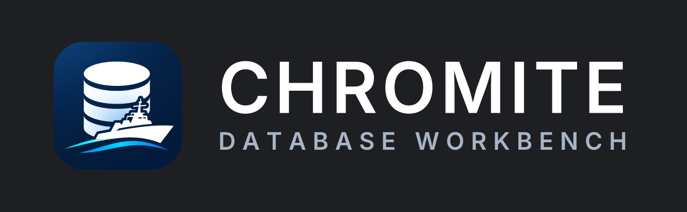

# Chromite

[](https://github.com/froiibn/chromite/releases/latest)
[](LICENSE.md)
[](#building-from-sources)
[](https://github.com/dbeaver/dbeaver)

Chromite is a multi-platform database workbench for developers, SQL programmers, database administrators and analysts.

Chromite is based on [DBeaver Community](https://github.com/dbeaver/dbeaver) and is distributed under the
[Apache License 2.0](LICENSE.md). It is an independent project and is not affiliated with, endorsed by or
sponsored by DBeaver Corp. "DBeaver" is a trademark of DBeaver Corp. See [NOTICE](NOTICE) for attribution details.

## Features

- Schema editor, SQL editor, data editor, ER diagrams, data export/import/migration, SQL execution plans,
  database administration tools, dashboards, spatial data viewer, proxy and SSH tunnelling, custom driver editor.
- 100+ database drivers out of the box, and any database that has a JDBC or ODBC driver.
- AI chat for working with SQL, data and database structure.

## Building from sources

Requirements: JDK 21 and Apache Maven 3.9+.

```bash
mvn package -f product/aggregate/pom.xml -T1C -Pproduct-chromite-swing
```

The built product is placed under `product/swing/target/products/com.seizia.chromite.swing.product/`.
Run the `chromite-swing` launcher.

## Architecture

- Written mostly in Java, built with Maven and Eclipse Tycho.
- [OSGi](https://en.wikipedia.org/wiki/OSGi) for plugins and dependency management.
- Swing ([FlatLaf](https://github.com/JFormDesigner/FlatLaf)) for the desktop UI.
- [JDBC](https://en.wikipedia.org/wiki/Java_Database_Connectivity) for database connectivity.
- [JSQLParser](https://github.com/JSQLParser/JSqlParser) and [ANTLR4](https://github.com/antlr/antlr4) for SQL parsing.
- Internal Java packages and bundle IDs use the `com.seizia.chromite.*` prefix (renamed from the upstream
  `org.jkiss.*` names in 2026, see [docs/chromite/internal-rename.md](docs/chromite/internal-rename.md)).

## Branding assets

Logo and icon sources are in [chromite_logo_pack](chromite_logo_pack).

## License

Apache License 2.0. See [LICENSE.md](LICENSE.md) and [NOTICE](NOTICE).
