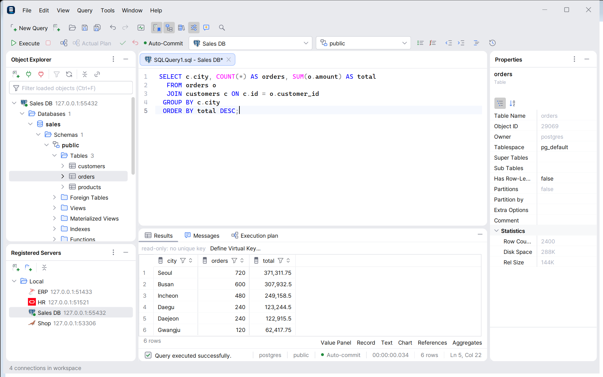

<p align="center">
  <picture>
    <source media="(prefers-color-scheme: dark)" srcset="site/assets/brand/logo-dark.svg">
    
  </picture>
</p>

<p align="center"><b>A database tool anyone can use easily and safely</b></p>

<p align="center">
  <a href="https://github.com/froiibn/chromite/releases/latest"></a>
  <a href="https://github.com/froiibn/chromite/actions/workflows/build.yml"></a>
  <a href="LICENSE.md"></a>
</p>

<p align="center">
  <a href="https://chromite.seizia.com/en/"><b>Download</b></a> ·
  <a href="https://chromite.seizia.com/ko/">한국어</a> ·
  <a href="https://chromite.seizia.com/en/support.html">Database support</a> ·
  <a href="https://chromite.seizia.com/en/changelog.html">Changelog</a>
</p>

<p align="center">
  <picture>
    <source media="(prefers-color-scheme: dark)" srcset="site/assets/shots/en-dark.webp">
    
  </picture>
</p>

Chromite is a database workbench for Windows and macOS. Connect to a server, run SQL, edit results right in the grid,
and manage tables and servers. It installs with its own Java runtime and JDBC drivers, so there is nothing else to set up.
Every feature is free, at work or at home.

## Download

Get the latest version from [chromite.seizia.com](https://chromite.seizia.com/en/) or from
[GitHub Releases](https://github.com/froiibn/chromite/releases/latest).

| Platform | Files |
|---|---|
| Windows 10 and 11 (x64) | Installer (`Chromite-<version>-x64-setup.exe`) or portable zip |
| macOS on Apple silicon | Disk image (`Chromite-<version>-arm64.dmg`) |

The Windows files are code-signed and the macOS app is signed and notarized. Each release lists SHA-256 checksums in
`SHA256SUMS`. Chromite tells you when a new version is out; the check can be turned off in Options.

## What it does

- **Safe by default.** The status line shows the open transaction, and nothing is committed or rolled back without
  asking. `UPDATE` and `DELETE` without `WHERE`, `DROP` and `TRUNCATE` ask before they run, and edits in the result grid
  can show their SQL before you save.
- **Query Library.** Save frequent queries and run them by filling in values. Share them with your team through a
  network folder or Git. While Chromite is running, a query can run at an interval or a time you set and notify you
  when its condition is met.
- **Chromite Agent.** Ask in plain words. It reads plans, locks, sessions, waits and space from the real database and
  answers with the evidence. Anything that changes the database shows its SQL and runs only after you confirm, and every
  tool call is written to an audit log. Providers: Claude, OpenAI and Google Gemini with your own API key, or a model
  you host yourself through Ollama or vLLM.
- **DBA tools.** The Activity Monitor brings sessions and locks, job schedulers, space and logs, maintenance and
  replication status into one place.
- **Procedure debugging.** Breakpoints, stepping, variables and the call stack for functions and procedures, where the
  database supports it.
- **Made for closed networks.** Commonly used drivers come pre-installed. Other drivers install from one offline bundle
  file, and with offline mode on Chromite does not try to download driver files.
- **Passwords stay on your computer.** Saved passwords and API keys are kept in the operating system's secure storage
  (DPAPI on Windows, the Keychain on macOS), never in workspace files. No usage statistics are collected.

Also included: SQL editor with execution plans, a result grid you can filter and edit in place, Object Explorer,
Registered Servers, a table designer, ER diagrams, data import and export, backup and restore, and schema compare.
The interface is in Korean and English, with light and dark themes.

## Databases

Chromite connects to any database that has a JDBC driver. How far each feature goes on each database is listed in
[Features and database support](https://chromite.seizia.com/en/support.html).

## Building from source

Requirements: JDK 25 ([JetBrains Runtime](https://github.com/JetBrains/JetBrainsRuntime) 25 recommended) and
Apache Maven 3.9 or later. Everything else the build needs is in this repository.

```bash
mvn package -f product/aggregate/pom.xml -T1C -Pproduct-chromite-swing
```

The product is written to `product/swing/target/products/com.seizia.chromite.swing.product/<os>/<ws>/<arch>/`.
Start the `Chromite` launcher there (`Chromite.exe` on Windows). The full build takes a while. Details are in
[docs/chromite/build.md](docs/chromite/build.md).

## Repository layout

| Path | Contents |
|---|---|
| `plugins/` | OSGi bundles: the model, the database plugins and the Swing UI (`com.seizia.chromite.ui.swing`) |
| `features/`, `product/` | Eclipse feature descriptors, the product (`product/swing`) and the aggregate build |
| `test/` | Test bundles |
| `deps/` | Build dependencies kept in the repository |
| `docs/chromite/` | Design documents (in Korean), starting at [README.md](docs/chromite/README.md) |
| `site/` | The download site |
| `tools/` | Release, installer, runtime, branding and name-check scripts |
| `chromite_logo_pack/` | Logo and icon sources |

Chromite is written in Java and built with Maven and Eclipse Tycho. It uses
[OSGi](https://en.wikipedia.org/wiki/OSGi) for plugins, Swing with [FlatLaf](https://github.com/JFormDesigner/FlatLaf)
for the interface, [JDBC](https://en.wikipedia.org/wiki/Java_Database_Connectivity) for database connectivity, and
[JSQLParser](https://github.com/JSQLParser/JSqlParser) and [ANTLR4](https://github.com/antlr/antlr4) for SQL parsing.

## Contributing and security

- Bug reports and feature requests: [Issues](https://github.com/froiibn/chromite/issues).
- Before sending a pull request, read [CONTRIBUTING.md](.github/CONTRIBUTING.md).
- To report a vulnerability, follow [SECURITY.md](SECURITY.md).

## License and attribution

Chromite is licensed under the [Apache License 2.0](LICENSE.md), which allows commercial use.

Chromite is based on [DBeaver Community](https://github.com/dbeaver/dbeaver) (Apache License 2.0). DBeaver is a
trademark of DBeaver Corp; Chromite is not affiliated with DBeaver Corp. The original copyright notices, and the licenses
of the JDBC drivers, Java runtime and fonts that ship with Chromite, are in [NOTICE](NOTICE).
